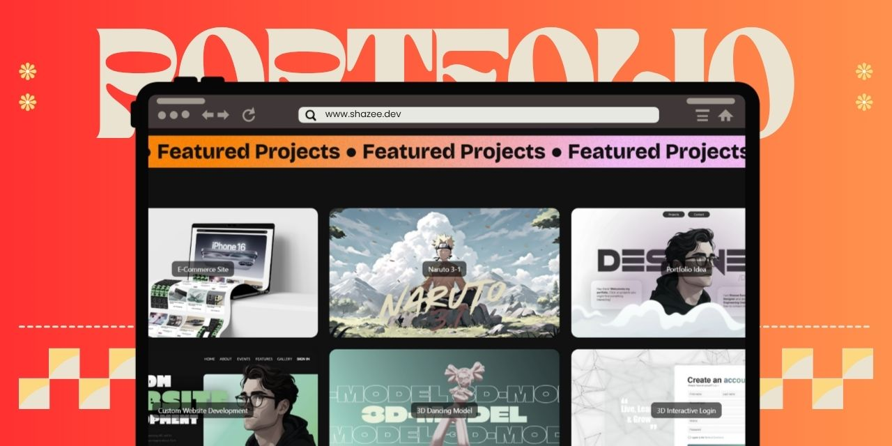

<div style="text-align: center;">
	<table>
	  <tr>
	    <td style="width: 50%;">
	      	<a href="#">
	    		
	  		</a>
	    </td>
	    <td style="width: 50%;">
	      	<a href="#">
	    		
	  		</a>
	    </td>
	  </tr>
	</table>
</div>

#### A static portfolio website that highlights:

- Hero area with smooth parallax and marquee animations
- About section with a flowing, hover‑reactive menu
- Projects grid with interactive, GSAP‑driven 3D tilt cards and live previews
- Skills marquee showcasing tech stack icons
- Contact section using EmailJS + reCAPTCHA with client‑side email validation
- Social dock that gently magnifies on hover

#### It’s implemented as a lightweight, CDN‑powered SPA—no build step required.

- Fast to host anywhere (GitHub Pages, Netlify, Vercel, your server)
- Easy to customize (semantic markup, modular CSS per section, isolated JS modules)
- Smooth, high‑polish feel (Lenis smooth scrolling, GSAP ScrollTrigger, parallax)
- Production‑ready SEO and social cards (meta tags, Open Graph, Twitter)

##

### Getting started

- This project is static. You can run it locally in seconds.

### Prerequisites

- Any modern browser
- Optional: VS Code with the Live Server extension for auto‑reload

### Run locally

- Double‑click `index.html` to open in your browser; or
- Use Live Server in VS Code (recommended for iteration)

### Deploy

You can deploy the repo as‑is to any static host. A custom domain is already used in the HTML’s canonical/meta tags. If you’re forking, update those tags.

- Live demo (production): Brian Dicky Vanka Andaraneva Portfolio

### Configuration

Most user‑facing content lives in HTML and the section‑specific JS files. Common edits:

- Social links: update anchors in `index.html` (GitHub, LinkedIn, etc.)
- Images: replace assets under `assets/images/` and project thumbnails under `assets/images/project-thumbnails/`
- Section styles: edit `assets/css/*.css` per section; shared styles in `assets/css/main.css`
- Animations: tune behaviors in these modules:
	- Hero parallax and scrolling marquees: `assets/js/hero-section.js`
	- About flowing menu: `assets/js/aboutme-section.js`
	- Projects tilt interactions: `assets/js/projects-section.js`
	- Skills marquee loop: `assets/js/skills-section.js`
	- Social dock magnify and scroll progress: `assets/js/main.js`
	- Mouse follower text and parallax bindings: `assets/js/mousefollower.js`

The contact form is wired to:

- EmailJS (send emails client‑side)
- AbstractAPI Email Validation (basic client‑side validation)

Sensitive values are loaded at runtime from a git‑ignored config file. Do this once after cloning:

1) Copy the example file and fill in your values

```
config.example.json → config.json
```

Fields in `config.json`:

- `emailJsPublicKey` — EmailJS Public Key
- `emailJsServiceId` — EmailJS Service ID
- `emailJsTemplateId` — EmailJS Template ID
- `abstractApiKey` — AbstractAPI Email Validation key

Notes:

- Client‑side keys are inherently public at runtime. Protect them with origin restrictions, quotas/rate limits, and monitoring in provider dashboards.
- The contact form may not work when loading the site via `file://` due to browser restrictions on `fetch`. Use a simple local server (e.g., VS Code Live Server).

##

### Project structure

```
index.html
assets/
	css/                # Section‑scoped and shared styles (Bootstrap included locally)
	js/                 # Modular scripts per section + utilities
	images/             # Banners, wallpapers, project thumbnails
	icons/, fonts/      # Icon set, font assets
```

Key entry points:

- Markup: `index.html`
- Styles: `assets/css/main.css` + section files (hero/about/skills/projects/contact)
- Scripts: `assets/js/*.js` (see Configuration)

##

### Help and support

- Have a question or found a bug? Open an issue on the repository.
